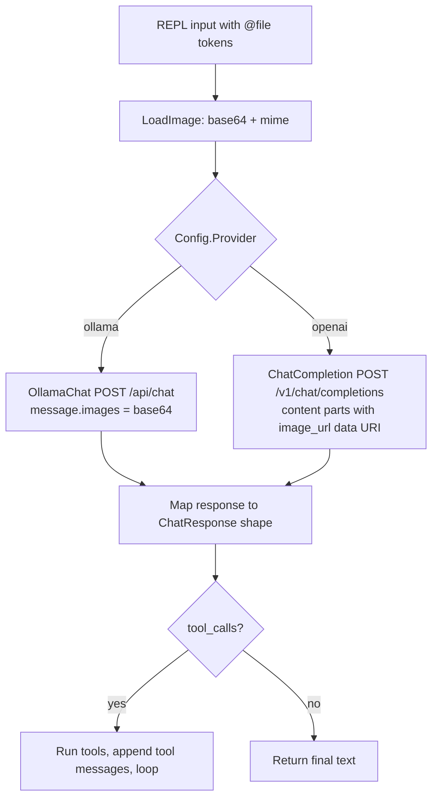

# Ollama + Image Support for the Harness

## Goal
1. Add first-class Ollama support (native `/api/chat` API) alongside the existing OpenAI-compatible path.
2. Add image (multimodal) support so users can attach images to their prompts, working with both Ollama native (`images: [base64]`) and OpenAI-compat (`content` parts with `image_url` data URIs).

## Current architecture
- `harness/client.go` — OpenAI-compat chat client + aux endpoints (`/v1/models`, `/props`, `/api/show`).
- `harness/types.go` — wire format: `Message{Role, Content string, ToolCalls...}`.
- `harness/harness.go` — agent loop `Ask()`.
- `harness/config.go` — `Config` + presets (`DefaultConfig`, `BdoConfig`).
- `main.go` — REPL; registers tools, calls `h.Ask(ctx, input)`.

## Design

### 1. Multimodal message format (types.go)
```
type Message struct {
    Role    string
    Content any            // string OR []ContentPart (OpenAI-compat multimodal)
    Images  []string       // Ollama native: base64 images, no data-URI prefix
    ToolCalls, ToolCallID, Name unchanged
}
type ContentPart struct {
    Type      string       // "text" | "image_url"
    Text      string
    ImageURL  struct { URL string }  // "data:image/png;base64,..."
}
```
- `Content any` marshals correctly for both shapes; tool/assistant messages keep plain strings.
- `ChatResponse.Choices[].Message.Content` becomes `any` too; harness extracts text via a helper that handles both string and parts.

### 2. Ollama native client (client.go)
- New method `OllamaChat(ctx, req) (*ChatResponse, error)`:
  - POST `rootURL() + "/api/chat"` with `{model, messages, tools, options:{num_ctx, temperature}, stream:false}`.
  - Response `{message:{role, content, tool_calls}, done, ...}` mapped into the existing `ChatResponse` shape so the agent loop is untouched.
  - Ollama tool-call arguments come back as an object → serialize to the JSON-string `FunctionCall.Arguments` the loop expects.
- `ContextLength` already handles Ollama `/api/show`.

### 3. Provider selection (config.go + harness.go)
- Add `Provider string` to `Config` (`"openai"` default, `"ollama"`).
- Add `OllamaConfig()` preset: `BaseURL http://localhost:11434/v1`, `Provider "ollama"`.
- `Harness.Ask` picks `Client.ChatCompletion` vs `Client.OllamaChat` based on `Config.Provider`.

### 4. Image input
- `harness/utils/utils.go`: `LoadImage(path) (base64 string, mime string)` — extension-based MIME detection (png/jpg/jpeg/gif/webp), size guard.
- `Harness.AskWithImages(ctx, input, imagePaths)`:
  - Ollama native: base64 strings into `Message.Images`.
  - OpenAI-compat: build `Content` parts `[{text}, {image_url: data URI}]`.
- `main.go` REPL: tokens starting with `@` (e.g. `@C:\pics\cat.png`) are extracted, loaded, stripped from the text, and passed to `AskWithImages`. Errors reported per-file, prompt continues.

### 5. Docs
- Update `harness/tools/readme.md` (or docs/) with an Ollama section: vision models (`llava`, `qwen2.5vl`), `@file` syntax, `num_ctx` note.

## Mermaid: message flow



## Todo list
1. types.go: multimodal `Message.Content any` + `Images []string` + `ContentPart`/`ImageURL` structs; text-extraction helper.
2. client.go: `OllamaChat` native `/api/chat` (non-streaming), tool-call arg serialization, response mapping.
3. config.go: `Provider` field + `OllamaConfig()` preset.
4. harness.go: provider dispatch in `Ask`; `AskWithImages` building provider-appropriate image payloads.
5. utils.go: `LoadImage` (base64 + MIME detection + size guard).
6. main.go: `@path` token parsing in REPL → `AskWithImages`.
7. Docs update (Ollama usage, vision models, `@file` syntax).
8. Manual test against Ollama with a vision model.
