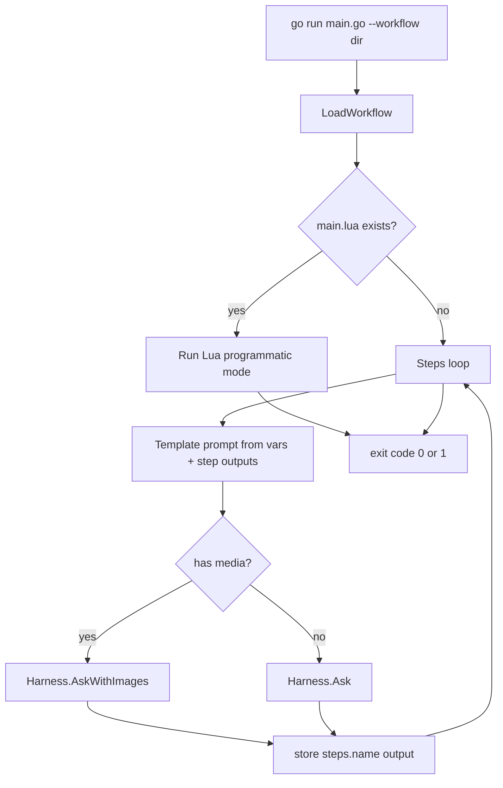

# Workflow Feature Design

## Goal

Run a declarative, directory-based workflow instead of the REPL:

```
go run main.go --workflow path/to/workflow
```

A workflow targets a `harness.Config` (overridable via YAML), chains LLM steps,
supports attachments (images), and exposes a rich Lua API for programmatic
control.

## Directory layout

```
my_workflow/
├── workflow.yaml      # required: config overrides + steps
├── main.lua           # optional: programmatic mode (overrides steps loop)
├── prompts/           # optional: prompt_file targets
│   └── summarize.txt
├── assets/            # optional: media attachments (png/jpg/...)
├── scripts/           # optional: per-step pre/post Lua scripts
└── tools/             # optional: per-workflow Lua tools (reuses luatool)
```

## workflow.yaml schema

```yaml
name: my_workflow
description: what it does

vars:                        # string vars usable in prompts as {{name}}
  topic: "quarterly earnings"

config:                      # partial overrides merged onto base Config
  provider: openai           # "ollama" | anything else
  base_url: http://localhost:11434/v1
  model: qwen2.5:14b
  api_key: ${MY_API_KEY}     # ${ENV} expansion; never hardcode keys
  system_prompt: |
    You are ...
  temperature: 0.3
  max_tool_iterations: 25
  max_context_tokens: 32768  # 0 = auto-probe via Client.ContextLength

tools:
  builtin: [current_time, read_file, list_files]   # or: all | none
  lua_dir: tools             # Lua tools registered into the Registry

steps:
  - name: summarize          # unique; result stored as steps.summarize
    prompt: "Summarize {{topic}}"       # inline, OR:
    # prompt_file: prompts/summarize.txt
    system_prompt: "optional per-step persona (resets history)"
    model: "other-model"                # optional per-step override
    temperature: 0.1
    media: [assets/chart.png]           # relative to workflow dir
    tools: none                         # none | all | [names] per-step
    pre_script: scripts/pre.lua
    post_script: scripts/post.lua
    save_as: summary                    # alias in harness.steps
    on_error: stop                      # stop | skip (default stop)

  - name: report
    prompt_file: prompts/report.txt     # may reference {{steps.summarize}}
```

Templating: `{{var}}` substituted from `vars`; `{{steps.<name>}}` from prior
step outputs. Simple `strings.ReplaceAll` pass, no external template engine.

## Execution model

- Base config = `harness.OllamaConfig()` (same default as today), overlaid by
  `config:` block. `api_key`/`base_url` support `${ENV_VAR}` expansion.
- If `main.lua` exists it fully drives execution (steps still callable via
  `harness.run_step("<name>")`); otherwise the runner executes `steps` in order.
- Each step runs the full agent loop through `Harness.Ask` / `AskWithImages`
  (media only for image-capable providers/models; non-image files error with a
  clear message).
- Per-step `system_prompt` starts a fresh Harness (fresh History) seeded with
  that prompt; otherwise conversation history carries across steps.
- Step output stored in `steps` table (Lua) and printed to stdout with token
  usage, same `[context: ...]` reporting as the REPL.
- Runner exits non-zero on `on_error: stop` failure.

## Lua API (new `harness` module in the workflow VM)

Registered on a gopher-lua state alongside the existing `http` and
`filesystem` modules (filesystem BaseDir = workflow directory):

| Function | Purpose |
|---|---|
| `harness.ask(prompt)` / `harness.ask(prompt, opts)` | run one agent turn; opts = `{model, temperature, media = {paths}, system, reset}` |
| `harness.ask_media(prompt, {paths})` | convenience wrapper for attachments |
| `harness.run_step(name)` | execute a declared YAML step from Lua |
| `harness.list_models()` | `{ {id=..., modified=..., size=...}, ... }` |
| `harness.context_length(model)` | probe server for context window |
| `harness.set_system_prompt(s)` | change persona (resets history) |
| `harness.step_results()` | map of completed step outputs |
| `harness.vars` / `harness.args` | workflow vars / extra CLI args |
| `harness.log(...)` / `harness.print(...)` | stdout logging |
| `json.encode(t)` / `json.decode(s)` | table <-> JSON string |

Step `pre_script` receives `step` table (name, prompt, media, vars, steps);
`post_script` receives `step` + `result` string.

## New Go surface

- `harness/workflow/loader.go` — YAML parse + validate + config merge.
- `harness/workflow/runner.go` — Harness/Registry assembly, steps loop,
  templating, media resolution, per-step overrides.
- `harness/workflow/lua_api.go` — `harness` Lua module + JSON helpers.
- `Client.ListModels(ctx)` in `harness/client.go` — `GET /v1/models` with
  fallback to Ollama native `GET /api/tags`.
- `main.go` — `--workflow <dir>` flag (stdlib `flag`); when present, run the
  workflow and exit; REPL path untouched.

## Flow



## Tests

- `loader_test.go`: table-driven YAML parse, validation errors, env expansion.
- runner test against `httptest` fake chat server (steps chaining + media
  shape for both providers).
- Lua API smoke test: `harness.ask` round-trip against fake server.

## Acceptance

- `go build ./...` and `go test ./...` pass.
- `go run main.go --workflow workflows/echo-demo` runs two chained steps
  against a local server; `workflows/models-report` lists models via
  `harness.list_models()`.
